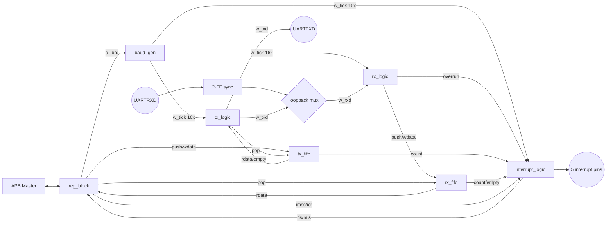

# Extended UART 설계 문서

> 대상: `proj2_make/TOP/1_RTL/` 의 RTL (top: `uart_ex_top`)
> ARM PL011 계열 UART를 참고한 APB 슬레이브 UART. TX/RX FIFO, 패리티, 브레이크, 루프백, 5개 인터럽트 지원.

---

## 1. 개요

| 항목 | 내용 |
|---|---|
| 버스 인터페이스 | APB (PREADY=1 고정, PSLVERR=0 고정 → wait/에러 없음) |
| 클럭 / 리셋 | `PCLK` 단일 클럭, `PRESETn` 비동기 assert / active-LOW |
| 프레임 | start(1) + data(8, LSB first) + parity(옵션, 1) + stop(1) |
| 패리티 | `PEN`으로 on/off, `EPS`로 짝수/홀수 |
| FIFO | TX 8bit × 16, RX 11bit × 16 (`FIFO_DEPTH` 파라미터, 2의 거듭제곱) |
| 보레이트 | `UARTIBRD`(정수 분주비)로 16× 틱 생성. 리셋값 217 → 33.333 MHz에서 9600 bps |
| 인터럽트 | RX, TX, RT(수신 타임아웃), 에러(OE/BE/PE/FE), 통합(UARTINTR) |
| 부가 기능 | 브레이크 송신/검출, 내부 루프백, RXD 2-FF 동기화기 |
| I/O 패드 | 없음 (포트가 코어 로직에 직접 연결) |

### 파라미터
| 이름 | 기본값 | 설명 |
|---|---|---|
| `FIFO_DEPTH` | 16 | TX/RX FIFO, interrupt_logic에 동일 값 전달 |
| `CNT_W` | `$clog2(FIFO_DEPTH)+1` | FIFO count 배선 폭 (0 ~ FIFO_DEPTH 표현) |

---

## 2. 파일 구성

| 파일 | 모듈 | 역할 |
|---|---|---|
| `uart_ex_top.v` | `uart_ex_top` | 블록 연결, RXD 동기화기, 루프백 선택기 |
| `reg_block.v` | `reg_block` | APB 슬레이브, 레지스터 파일, UARTFR 생성 |
| `baud_gen.v` | `baud_gen` | 16× 보레이트 틱 생성 |
| `tx_fifo.v` | `tx_fifo` | 원형 버퍼 동기 FIFO (범용, RX에서도 재사용) |
| `rx_fifo.v` | `rx_fifo` | `tx_fifo`를 DATA_WIDTH=11로 감싼 래퍼 |
| `tx_logic.v` | `tx_logic` | 송신 FSM (직렬화, 패리티, 브레이크) |
| `rx_logic.v` | `rx_logic` | 수신 FSM (start 검출, 중앙 샘플링, 에러 판정) |
| `interrupt_logic.v` | `interrupt_logic` | RIS/MIS, RT 타이머, 인터럽트 핀 5개 |

---

## 3. 블록 다이어그램



### 데이터 경로
1. **송신**: APB write(UARTDR) → `reg_block` → `tx_fifo` → `tx_logic` → `UARTTXD`
2. **수신**: `UARTRXD` → 2-FF 동기화 → 루프백 선택 → `rx_logic` → `rx_fifo` → `reg_block` → APB read(UARTDR)
3. **알림**: FIFO count / 에러 이벤트 → `interrupt_logic` → 인터럽트 핀 5개
4. **타이밍**: `reg_block`(IBRD) → `baud_gen` → 16× 틱 → TX, RX, 인터럽트(RT 타이머)

---

## 4. 포트 (uart_ex_top)

| 포트 | 방향 | 폭 | 설명 |
|---|---|---|---|
| `PCLK` | in | 1 | 클럭 |
| `PRESETn` | in | 1 | 비동기 리셋, active-LOW |
| `PSEL` | in | 1 | APB select |
| `PENABLE` | in | 1 | APB enable (ACCESS phase) |
| `PWRITE` | in | 1 | 1 = write |
| `PADDR` | in | [11:2] | 워드 주소 (하위 2비트 없음) |
| `PWDATA` | in | 32 | 쓰기 데이터 |
| `PRDATA` | out | 32 | 읽기 데이터 |
| `PREADY` | out | 1 | 항상 1 |
| `PSLVERR` | out | 1 | 항상 0 |
| `UARTRXD` | in | 1 | 직렬 수신 입력 (비동기) |
| `UARTTXD` | out | 1 | 직렬 송신 출력 (루프백 중에도 w_txd 출력) |
| `UARTRXINTR` | out | 1 | RX 인터럽트 |
| `UARTTXINTR` | out | 1 | TX 인터럽트 |
| `UARTRTINTR` | out | 1 | 수신 타임아웃 인터럽트 |
| `UARTEINTR` | out | 1 | 에러 인터럽트 (OE/BE/PE/FE의 OR) |
| `UARTINTR` | out | 1 | 통합 인터럽트 (MIS 전체 OR) |

### 입력 경로 보조 회로 (top)
- **2-FF 동기화기**: `r_rxd_s1 → r_rxd_s2`. 리셋값 1(idle)이라 리셋 직후 가짜 start bit이 생기지 않음.
- **루프백 선택기**: `w_rxd = CR.LBE ? w_txd : r_rxd_s2`. 외부 핀 `UARTRXD`는 루프백 중 무시됨.

---

## 5. 레지스터 맵

`PADDR[11:2]` = 바이트 오프셋 / 4. 정의되지 않은/쓰기 전용 주소의 읽기값은 0.

| 오프셋 | 이름 | 접근 | 저장 | 리셋값 |
|---|---|---|---|---|
| 0x000 | UARTDR | R/W | FIFO 통과 | – |
| 0x018 | UARTFR | R | 없음(상태 조합) | – |
| 0x024 | UARTIBRD | R/W | FF | 0x00D9 (217) |
| 0x02C | UARTLCR_H | R/W | FF | 0x0 |
| 0x030 | UARTCR | R/W | FF | 0x300 (RXE=1, TXE=1) |
| 0x038 | UARTIMSC | R/W | FF | 0x0 |
| 0x03C | UARTRIS | R | 없음 | – |
| 0x040 | UARTMIS | R | 없음 | – |
| 0x044 | UARTICR | W | 펄스 | – |

### UARTDR (0x000)
- **Write**: `PWDATA[7:0]` → TX FIFO push (ACCESS phase 1클럭). FIFO가 가득 차 있으면 FIFO에서 무시됨.
- **Read**: RX FIFO 헤드 `{BE[10], PE[9], FE[8], DATA[7:0]}` 반환, 동시에 RX FIFO pop. FIFO가 비었으면 0 (empty 시 FIFO 출력이 쓰레기값이라 마스킹).

### UARTFR (0x018)
| 비트 | 이름 | 의미 |
|---|---|---|
| 7 | TXFE | TX FIFO empty |
| 6 | RXFF | RX FIFO full |
| 5 | TXFF | TX FIFO full |
| 4 | RXFE | RX FIFO empty |
| 3 | BUSY | `TX FIFO 비어있지 않음 OR tx_logic 동작 중` (마지막 문자가 FIFO를 떠나도 선로에서 아직 전송 중일 수 있어서 FIFO만으로는 부족) |
| 그 외 | – | 0 |

### UARTIBRD (0x024)
- `[15:0]` 정수 분주비. 0이면 틱이 나오지 않음.
- 공식: `IBRD = f(PCLK) / (16 × baud)` → 33.333 MHz, 9600 bps → 217.

### UARTLCR_H (0x02C)
| 비트 | 이름 | 의미 |
|---|---|---|
| 2 | EPS | 1 = 짝수 패리티, 0 = 홀수 패리티 |
| 1 | PEN | 1 = 패리티 비트 사용 |
| 0 | BRK | 1 = 브레이크 송신 |

### UARTCR (0x030)
| 비트 | 이름 | 의미 |
|---|---|---|
| 9 | RXE | 수신 enable |
| 8 | TXE | 송신 enable |
| 7 | LBE | 루프백 enable |
| 0 | UARTEN | 마스터 스위치 |

실제 enable = `UARTEN && TXE` (→ `o_tx_en`), `UARTEN && RXE` (→ `o_rx_en`). 리셋 후 UARTEN=0이라 소프트웨어가 켜야 동작.

### UARTIMSC / UARTRIS / UARTMIS (0x038 / 0x03C / 0x040)
세 레지스터 모두 `[10:4]`에 7비트 배치.

| 레지스터 비트 | 인터럽트 | 내부 7비트 벡터 index |
|---|---|---|
| 4 | RX | [0] |
| 5 | TX | [1] |
| 6 | RT (수신 타임아웃) | [2] |
| 7 | FE (프레이밍 에러) | [3] |
| 8 | PE (패리티 에러) | [4] |
| 9 | BE (브레이크 에러) | [5] |
| 10 | OE (오버런 에러) | [6] |

- `RIS` = 마스크와 무관한 원시 상태, `MIS = RIS & IMSC`.

### UARTICR (0x044, write-only)
- 쓴 값의 1인 비트가 1클럭 clear 펄스가 됨. 매핑: `o_icr = {PWDATA[10:6], 2'b00}` → RT=bit6, FE=bit7, PE=bit8, BE=bit9, OE=bit10.
- RX/TX(레벨형)는 ICR로 지울 수 없음 (FIFO 레벨을 따라감).

---

## 6. 모듈별 상세 설계

### 6.1 baud_gen
- 16비트 카운터 `r_count`가 0 → `IBRD-1`까지 세고 0으로 복귀.
- `o_tick_16x = (IBRD != 0) && (r_count == IBRD-1)` → PCLK 1주기 폭의 펄스.
- 비트 하나 = 틱 16개 → 보레이트 = `f(PCLK) / (IBRD × 16)`.
- `IBRD == 0`이면 카운터 정지, 틱 없음.
- TX, RX, RT 타이머가 모두 이 틱 하나를 공유.

### 6.2 tx_fifo / rx_fifo
- 원형 버퍼. `r_wptr`, `r_rptr`(PTR_W비트, 자연 wrap), `r_count`(CNT_W비트).
- `wptr == rptr`는 empty/full 모두에서 참이라 **count로 empty/full 구분**.
- `w_do_push = push && !full`, `w_do_pop = pop && !empty` — 불가능한 요청은 무시.
- **동시 push+pop 규칙**
  - full: push 버리고 pop만 수행 (count `DEPTH → DEPTH-1`, 엄격 규칙)
  - empty: pop 무시, push만 수행
  - 그 외: count 유지
- `o_rdata`는 조합 읽기(`r_mem[r_rptr]`), `o_empty=0`일 때만 유효. 메모리는 리셋하지 않음.
- `rx_fifo`는 `tx_fifo`를 `DATA_WIDTH=11`로 인스턴스화한 래퍼.

### 6.3 tx_logic (송신 FSM)

```
IDLE ──w_load──▶ START ─▶ DATA(×8) ─▶ [PARITY] ─▶ STOP ─┬─ w_load ─▶ START (연속 전송)
  │                                                       ├─ brk && tx_en ─▶ BREAK
  └─ tick && brk && tx_en ─▶ BREAK                       └─ 그 외 ─▶ IDLE
BREAK ── tick && !brk ──▶ STOP
```

- 모든 상태 전이와 카운터 갱신은 `i_tick_16x == 1`인 클럭에서만 일어남.
- `w_can_start = tx_en && !fifo_empty && !brk`
- `w_bit_end = tick && (r_tick_cnt == 15)` (비트당 16틱)
- **`w_load` (시작 시점)**: ① IDLE에서 틱 + 시작 허가, ② STOP이 끝나는 시점 + 시작 허가(IDLE을 거치지 않고 다음 프레임 연결). 이 클럭에 다음이 동시에 일어남:
  - `o_fifo_pop` 1클럭 펄스
  - `r_shift` ← FIFO 헤드, `r_par` ← 패리티 값 (pop 직후 FIFO는 다음 항목을 보여주므로 이 시점에 캡처)
  - START 전이
- 데이터는 `r_shift >> 1`로 LSB부터 `r_shift[0]` 창으로 출력.
- 패리티: `^data`는 1의 개수가 홀수면 1(=짝수 패리티 비트). `EPS=1`이면 그대로, `0`이면 반전.
- 출력(`o_txd`)은 상태별 조합: IDLE=1, START=0, DATA=`r_shift[0]`, PARITY=`r_par`, STOP=1, BREAK=0.
- **설계 결정**
  - 진행 중인 프레임은 `i_tx_en`이 내려가도 끝까지 전송. `tx_en`은 새 프레임/브레이크 시작 때만 확인.
  - **D1**: 브레이크는 `tx_en=1`일 때만 진입, `i_brk=0`이 되어야 탈출.
  - **D2**: 브레이크 중에도 `o_tx_busy=1` (`r_state != IDLE`).
  - BREAK 해제 시 STOP을 거쳐 선로를 16틱간 1로 유지 (BREAK/IDLE에서는 `r_tick_cnt`를 세지 않아 STOP이 항상 16틱).

### 6.4 rx_logic (수신 FSM)

```
IDLE ─(start edge && rx_en)▶ START ─(8틱째 rxd=0)▶ DATA(×8) ─▶ [PARITY] ─▶ STOP ─(중앙)▶ IDLE
                              └(8틱째 rxd=1: 글리치)▶ IDLE
```

- `w_start_edge = r_rxd_d && !i_rxd` — 틱이 아닌 **매 클럭**에서 falling edge를 검출해 위상 오차를 최소화.
- START: 8번째 틱(셀 중앙)에서 다시 0인지 확인. 1이면 글리치로 보고 IDLE 복귀.
- 이후 16틱마다(= 각 비트 셀의 중앙) 샘플링. `r_shift = {i_rxd, r_shift[7:1]}` (LSB first이므로 8번 후 D0이 bit0).
- STOP에서 **정지 비트 중앙**에서 바로 IDLE로 복귀 → 다음 start bit를 놓치지 않음.
- `i_rx_en`은 IDLE에서만 확인.
- **에러 판정** (stop 샘플 시점)
  - `FE` = stop 셀이 0
  - `PE` = `PEN && (기대 패리티 != 수신 패리티)` 이되, 브레이크면 마스킹
  - `BE` = `FE && data==0x00 && (!PEN || parity==0)`
  - 브레이크 프레임은 `BE=1, FE=1, PE=0`으로 보고 (홀수 패리티에서 PE가 우연히 켜지는 것 방지)
- **출력**: `o_fifo_wdata = {BE, PE, FE, DATA}`
  - `o_fifo_push = stop_end && !fifo_full`
  - `o_overrun = stop_end && fifo_full` (문자는 버려짐)
  - 둘 다 1클럭 펄스.

### 6.5 interrupt_logic

- **레벨형 (플립플롭 없음)**
  - RX: `rx_count >= FIFO_DEPTH/2`
  - TX: `tx_count <= FIFO_DEPTH/2`
- **래치형**: FE, PE, BE, OE, RT — 이벤트로 set, ICR로 clear.
  - 우선순위: reset > set > ICR clear > hold. **set이 clear보다 우선**이라 ICR 쓰기와 같은 클럭에 새 에러가 와도 놓치지 않음.
  - FE/PE/BE set은 `i_rx_push`와 함께 유효한 에러 비트로만 발생. 오버런으로 버려진 문자는 push가 없으므로 OE만 set.
- **RT (수신 타임아웃)**
  - `r_rt_cnt`(10비트)가 틱 단위로 증가, 한계 `RT_CNT = 512` 틱 (= 32비트 시간).
  - 우선순위: reset > rx_push(0으로 재시작) > rx_empty(0 유지) > 틱 +1 (512에서 정지, wrap 없음).
  - set 조건: `tick && cnt==511 && !rx_empty && !rx_push` — 타이머와 항상 일치하도록 4개 조건 모두 필요.
  - clear: `ICR[2]` 또는 RX FIFO가 빔. ICR로 지운 뒤에는 새 문자가 타이머를 재시작할 때까지 다시 set되지 않음.
- **출력**: `o_ris`, `o_mis = ris & imsc`, `RXINTR=mis[0]`, `TXINTR=mis[1]`, `RTINTR=mis[2]`, `EINTR=|mis[6:3]`, `INTR=|mis`. 모든 핀은 RIS가 아니라 **MIS**에서 나옴.

### 6.6 reg_block
- 레지스터 세 종류
  - **설정**(FF 저장): IBRD, LCR_H, CR, IMSC
  - **상태**(저장 없음): FR, RIS, MIS
  - **통과**(동작만): DR(FIFO로), ICR(펄스로)
- APB 디코드: SETUP(`PSEL=1, PENABLE=0`)에서는 아무것도 안 하고, ACCESS(`PSEL && PENABLE`)에서만 실제 동작 → `w_wr_en`/`w_rd_en`이 전송당 정확히 1클럭.
- 읽기 mux는 조합 로직이라 PRDATA가 같은 ACCESS 사이클에 유효.

---

## 7. 동작 시나리오

### 송신
1. `UARTIBRD`, `UARTLCR_H` 설정 → `UARTCR`에 `UARTEN=1` (TXE는 리셋값 1)
2. `UARTDR` 쓰기 → TX FIFO push, `empty` 해제
3. `tx_logic`이 다음 틱에서 `w_load` → pop + START 진입
4. start → data(LSB first) → [parity] → stop 순서로 비트당 16틱씩 출력
5. FIFO에 데이터가 더 있으면 STOP 종료 시점에 IDLE을 거치지 않고 바로 다음 START

### 수신
1. `UARTCR`에서 `UARTEN=1`, `RXE=1`
2. start edge 검출 → 중앙(8틱)에서 재확인 → 이후 16틱마다 샘플
3. stop 중앙에서 `{BE,PE,FE,DATA}`를 RX FIFO에 push (가득 차 있으면 overrun)
4. 소프트웨어는 `UARTRIS/MIS`나 인터럽트로 확인 후 `UARTDR` 읽기(= pop)

### 루프백
`UARTCR.LBE=1` → `rx_logic` 입력이 내부 `w_txd`로 전환. 외부 `UARTRXD`는 무시되지만 `UARTTXD` 핀에는 계속 송신 신호가 나옴.

---

## 8. 합성 / 검증 현황

### 타이밍 제약 (`3_SYN/cons/uart_ex_top.sdc`)
- `MAIN_CLOCK` 주기 8 ns (원 설계 10 ns에 80% 마진 적용), 소스/네트워크 latency 0.2 ns, setup uncertainty 0.1 ns, transition 0.1 ns.
- 라이브러리: slow (0.9V, 125°C) / fast (1.1V, 0°C), 45nm 계열.

### Genus 합성 결과 (`3_SYN/report/19_uart_ex_top_SYN_qor.rpt`, slow corner)
| 항목 | 값 |
|---|---|
| Critical path slack | +6173.7 ps (violating path 0) |
| Leaf instance | 1234 (sequential 432 / combinational 802) |
| Cell area | 4998.33 |
| Total area (cell+net) | 6628.67 |
| 총 전력 | 약 2.65e-4 W (leakage 2.8e-7 W) |

### 테스트벤치 (`2_SIM/TESTBENCH/`)
`tb_baud_gen`, `tb_tx_fifo`, `tb_rx_fifo`, `tb_tx_logic`, `tb_rx_logic`, `tb_interrupt_logic`, `tb_reg_block`, `tb_uart_ex_top` — 블록 단위 + 전체 통합. Xcelium(xrun)으로 실행 (`2_SIM/FUNCTION/run_function.tcl`).

### 후속 단계
`3_SYN`(Genus 합성) → `5_PNR`(Innovus: InitDesign → PowerPlan → PlaceOpt → CTS → Route → ChipFinish → ECO) 진행됨. 패드 셀은 사용하지 않음.

---

## 9. 참고 / 주의사항

- 클럭 주파수 표기가 두 군데 다름: `reg_block`의 IBRD 리셋값 217은 **33.333 MHz 기준 9600 bps**, SDC의 타이밍 목표는 **8 ns(125 MHz)**. 실제 보레이트는 쓰는 PCLK에 맞춰 `UARTIBRD`를 다시 설정해야 함.
- 분주는 정수(IBRD)만 지원. PL011의 소수 분주(FBRD)는 없음.
- 데이터 비트는 8비트 고정, 정지 비트는 1비트 고정 (2 stop bit, 5~7 data bit 미지원).
- RX 에러 비트 `{BE,PE,FE}`는 문자와 함께 FIFO에 저장되어 `UARTDR` 읽기로 확인하고, 동시에 래치형 인터럽트(RIS)로도 알려짐.
- 인터럽트 벡터 순서 `[6]=OE [5]=BE [4]=PE [3]=FE [2]=RT [1]=TX [0]=RX` 는 IMSC / RIS / MIS / ICR / 내부 배선 전부 동일.
